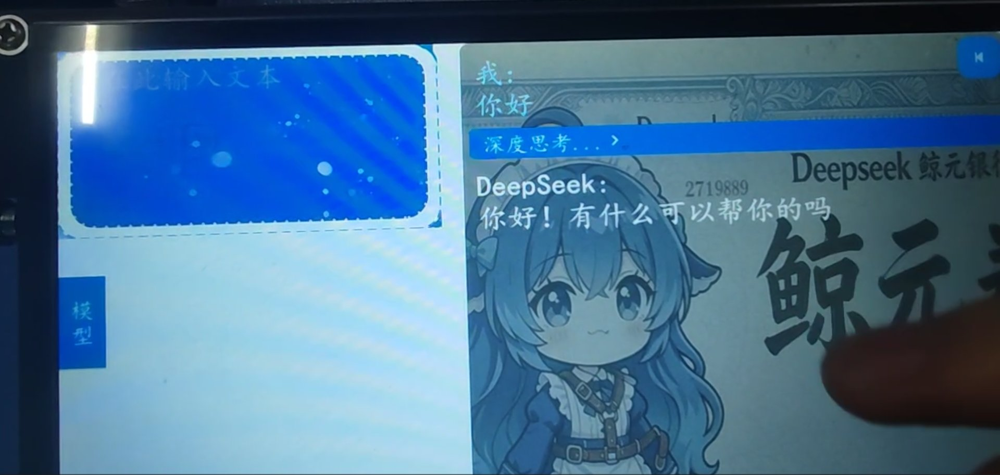
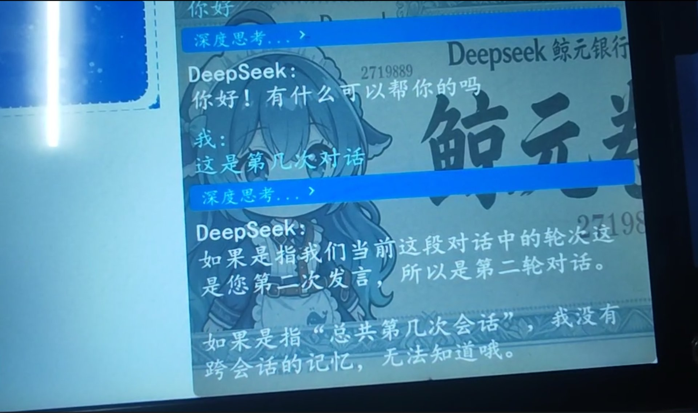
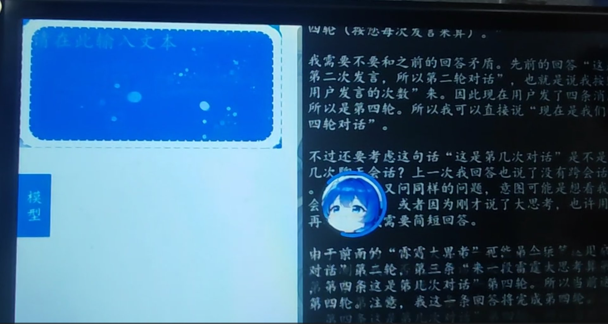
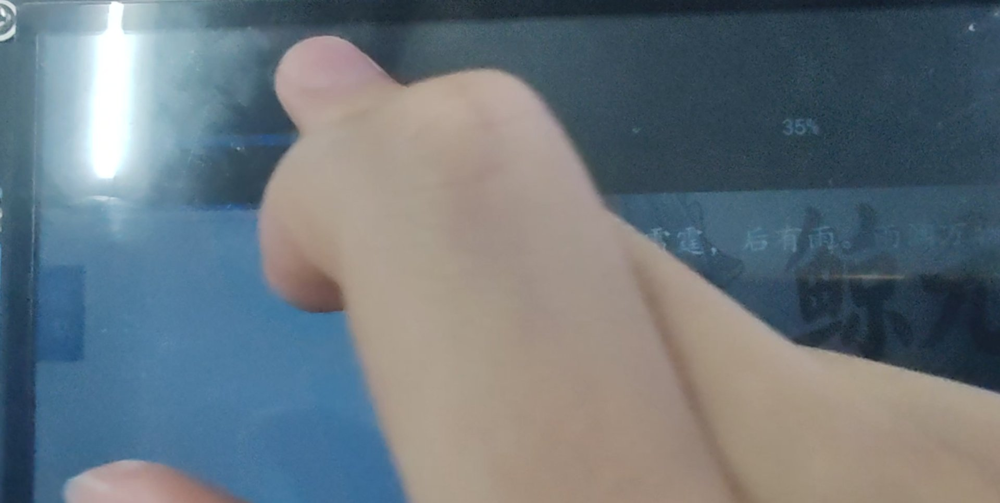
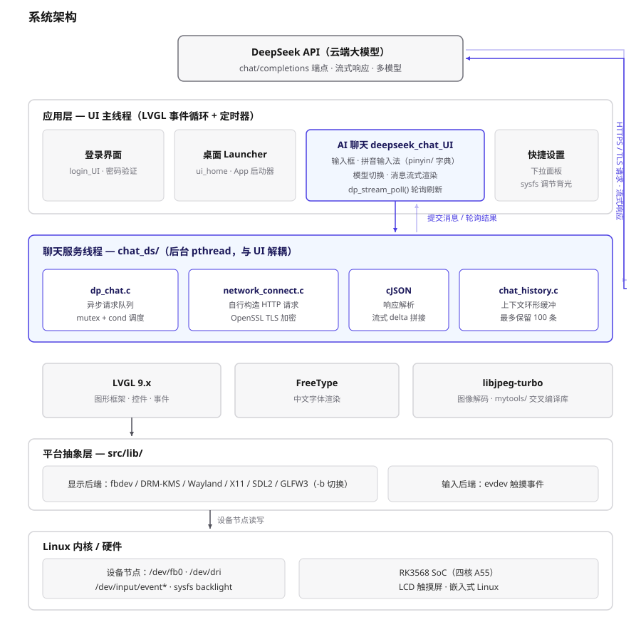

# 基于 RK3568 与 LVGL 的 AI 智能体聊天终端

运行在 RK3568 嵌入式 Linux 开发板上的 AI 聊天终端。界面基于 LVGL 9.x 全屏触控构建，
通过 OpenSSL 直接与 DeepSeek 大模型 API 进行 HTTPS 通信，实现中文对话、模型切换与多轮上下文。

## 效果演示

| AI 聊天对话 | 多轮上下文记忆 |
| --- | --- |
|  |  |
| **深度思考输出** | **下拉快捷设置（背光调节）** |
|  |  |

## 功能特性

- **登录界面**：密码验证通过后进入系统
- **手机式桌面**：App 图标启动器，新增应用只需往 `home_apps[]` 数组加一行
- **AI 聊天**
  - 直连 DeepSeek API：OpenSSL 完成 TLS 握手，自行构造 HTTP 请求，cJSON 解析响应
  - 多模型切换：`deepseek-v4-flash` / `deepseek-v4-pro` / `deepseek-v4-flash-vision-exp`
  - 中文拼音输入法：内置拼音字典，无需外部输入法
  - 多轮对话历史：最多保留 100 条上下文
- **快捷设置**：顶部下拉面板，通过 sysfs 调节屏幕背光亮度
- **多显示后端**：fbdev、DRM/KMS、SDL2、Wayland、X11、GLFW3，可用 `-b` 参数指定

## 系统架构



自底向上分为五层：RK3568 硬件 → 内核设备节点 → 图形框架与通信层 → 应用层 → DeepSeek 云端。
紫色标出 AI 聊天的主链路：触摸输入经 LVGL 事件进入聊天界面，由 `chat_ds` 通过 TLS 请求云端，响应经 cJSON 解析后回填到消息列表。

## 目录结构

| 路径 | 说明 |
| --- | --- |
| `src/main.c` | 程序入口：初始化 LVGL、显示后端与聊天线程 |
| `src/app_ui.c` | 应用启动流程（字体初始化 → 登录界面） |
| `src/login_UI/` | 登录界面 |
| `src/ui_home.c` | 手机式桌面（App 启动器） |
| `src/ui_quick_settings.c` | 顶部下拉快捷设置（背光亮度） |
| `src/deepseek_chat_UI/` | 聊天界面：输入框、模型选择、消息输出 |
| `src/pinyin/` | 拼音输入法字典 |
| `src/lib/` | LVGL Linux 显示与输入后端驱动 |
| `chat_ds/` | DeepSeek API 客户端（TLS、HTTP、JSON、对话历史） |
| `lvgl/` | LVGL 图形库源码 |
| `mytools/` | 交叉编译用预编译库：FreeType、libjpeg-turbo、OpenSSL |

## 编译

### Makefile（默认，交叉编译到开发板）

Makefile 默认使用 `aarch64-linux-gcc`，并链接 `mytools/` 下的预编译库：

```bash
make -j
```

产物为 `build/bin/main`。若工具链名称不同，修改 Makefile 开头的 `CC` / `CXX` 即可。

### CMake（可选）

```bash
cmake -DCMAKE_TOOLCHAIN_FILE=./user_cross_compile_setup.cmake -B build -S .
make -C build -j
```

需先在 `user_cross_compile_setup.cmake` 中填写实际 SDK 的工具链路径。

## 配置 API Key

仓库不包含真实密钥。首次编译前，先复制模板并填入自己的 key：

```bash
cp chat_ds/include/api_key.example.h chat_ds/include/api_key.h
```

然后编辑 `chat_ds/include/api_key.h`，把 `YOUR_API_KEY_HERE` 替换为你的 DeepSeek API Key。

`api_key.h` 已写入 `.gitignore`，不会提交到仓库。

## 运行

将 `build/bin/main` 拷贝到开发板执行：

```bash
./main
```

指定显示后端（编译时启用了多个后端的情况）：

```bash
./main -b fbdev
```

用 `./main -B` 可列出当前编译支持的显示后端。

> 使用 fbdev 或 DRM 输出时通常需要 root 权限：`sudo ./main`

## 说明

界面框架源自 LVGL 官方 [lv_port_linux](https://github.com/lvgl/lv_port_linux) 模板。
